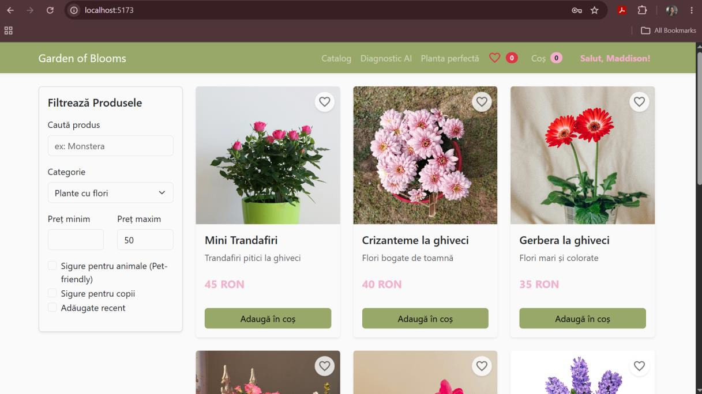
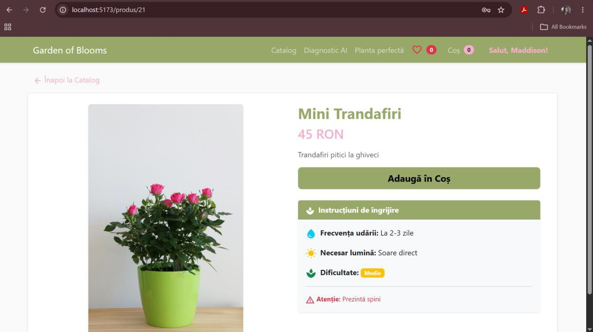
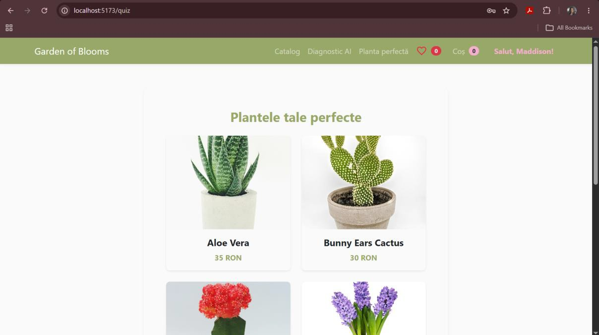
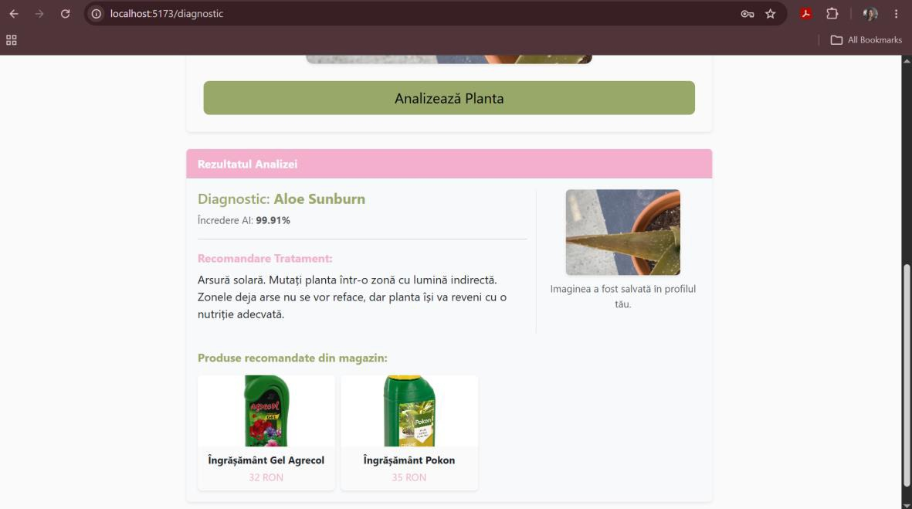
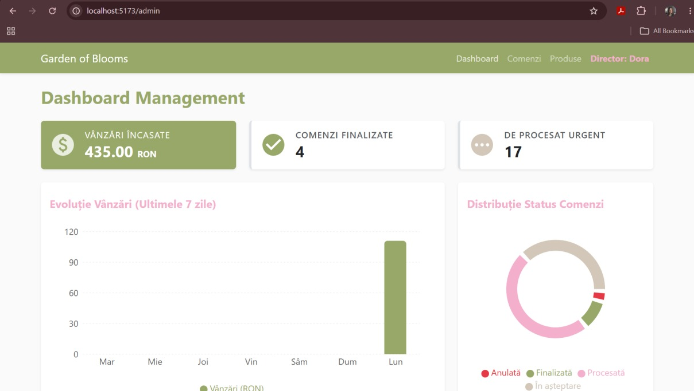

# ❀ Garden of Blooms ❀

## Introduction
Garden of Blooms is a full-stack e-commerce platform that doubles as a personal botanical assistant. It aims to solve a problem many of us have encountered. People love buying house plants, but often struggle to keep them alive. Instead of just selling plants, this app helps users pick the right ones for their lifestyle and uses AI to diagnose sick plants, boosting customer retention by giving them all the information they need to make their very own plant garden flourish.   

## Tech Stack
- **Frontend:** React, Redux, React-Bootstrap, Material-UI.
- **Backend:** Python, FastAPI, SQLAlchemy, Pydantic.
- **Database:** PostgreSQL (with custom PL/pgSQL triggers and procedures).   
- **AI / Machine Learning:** PyTorch (ResNet-18 CNN).
- **Security:** JWT authentication, bcrypt encryption, Role-Based Access Control (RBAC). 

## Key Features
**Core E-commerce & User Experience** 
The platform features a dynamic catalog equipped with fast filters for category, price, and safety criteria, alongside detailed plant care instructions on every product page. The shopping experience is streamlined through a smooth cart and checkout flow featuring auto-filled forms for logged-in users. Additionally, a personal user dashboard allows customers to easily track their order history, accumulated loyalty points, and past AI diagnoses.

**Interactive Recommendation System** 
To combat decision fatigue, the app includes a Smart Plant Quiz that asks simple lifestyle questions regarding light levels, gardening experience, and pet ownership. The algorithm acts as a virtual consultant, automatically filtering out dangerous plants (such as toxic species for pet owners) and recommending the perfect botanical matches for the user's specific environment.

**AI Plant Doctor** 
Users can access immediate post-sale support by uploading a photo of a sick plant leaf directly in the app. The AI model analyzes the image to identify the disease and suggest care tips. Furthermore, the system performs automated cross-selling by recommending specific treatments (like fertilizers or fungicides) that are currently available in the shop's inventory.

**Admin Dashboard & Business Intelligence** 
The management team is equipped with a visual dashboard tracking key performance indicators (KPIs) such as sales, revenue, and order statuses. The secure interface features an order management system that automatically updates inventory in real-time upon processing, alongside a smart inventory controller that autonomously applies commercial discounts to older, perishable plants to minimize financial losses.

## The AI Model Under the Hood
The "Plant Doctor" is powered by a ResNet-18 Convolutional Neural Network, trained on the [Multi-Species Indoor Plant Disease Dataset](https://www.kaggle.com/datasets/abdulahad0296/indoor-plant-disease-detection-dataset). Data Augmentation techniques like random rotations, brightness, and contrast tweaks  ensured the model performs well on regular, imperfect smartphone photos.

## What I Learned

In the process of building this system, I faced many challenges, but also learned a lot:
* **Automations:** I learned how to push repetitive logic down to the database level using PostgreSQL triggers and stored procedures (like auto-calculating loyalty points or managing stock limits) to keep the backend fast and clean.
* **Connecting AI to Business Value:** I figured out how to take a raw Machine Learning model and turn it into a profitable business feature by linking the AI's diagnosis to actual store products that customers can purchase to help solve their problems.
* **Decoupled Architecture:** I managed to orchestrate a smooth, reactive frontend with an asynchronous FastAPI backend that handles standard shop requests without getting blocked by heavy image processing tasks.